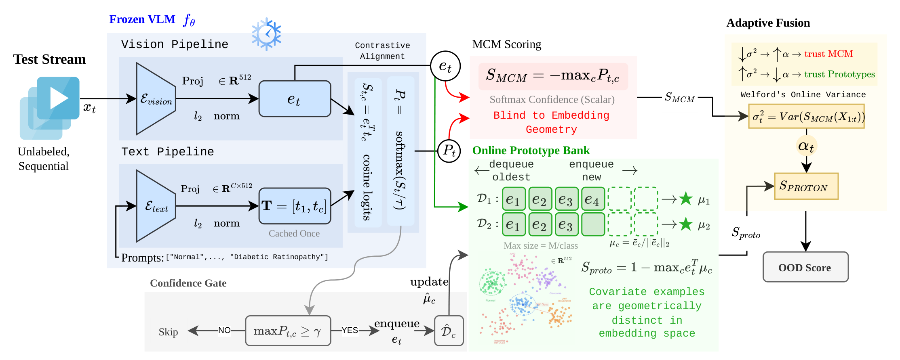
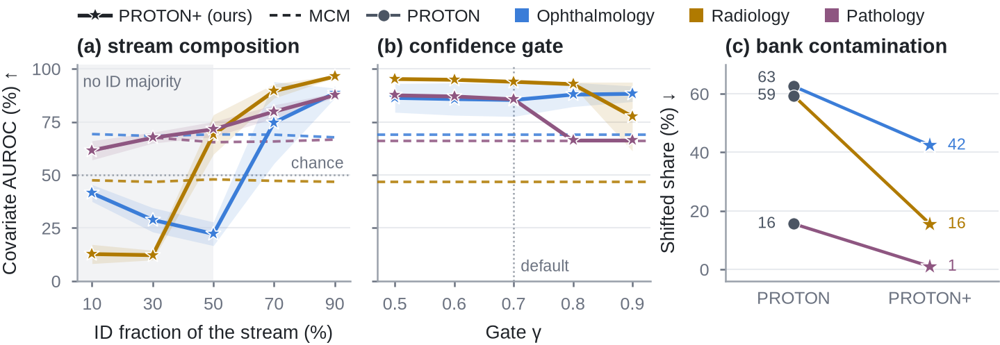
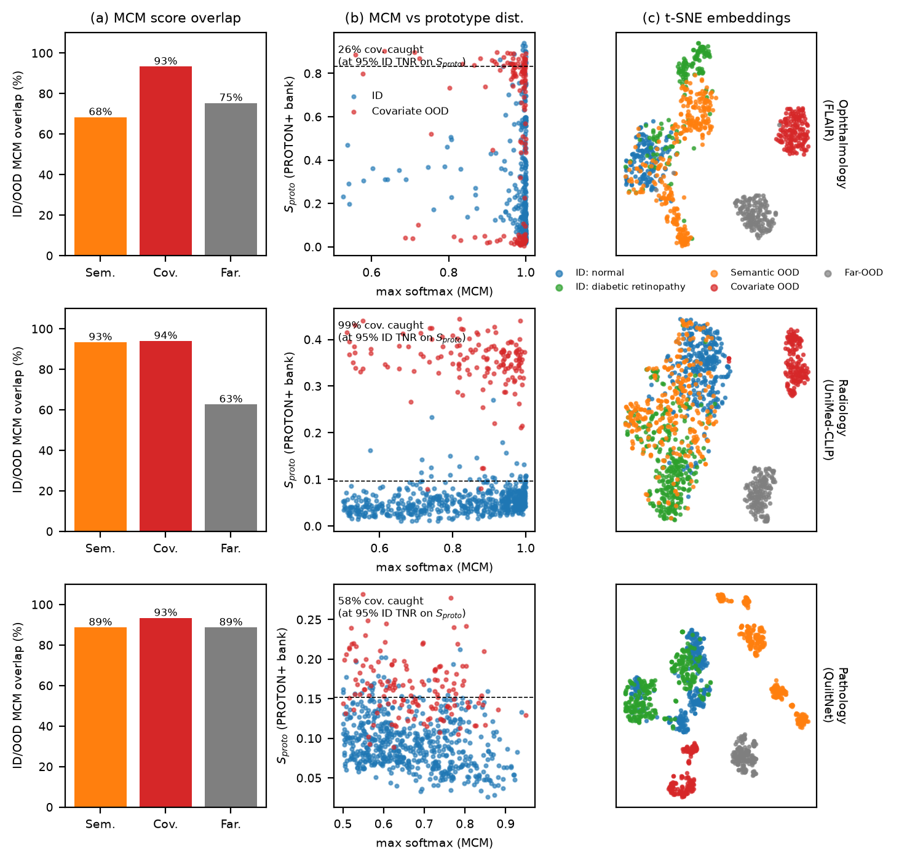
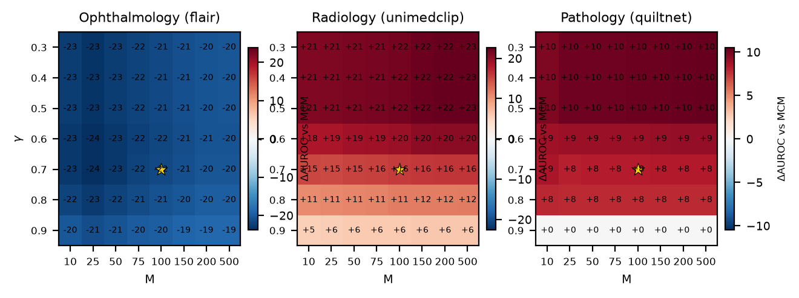
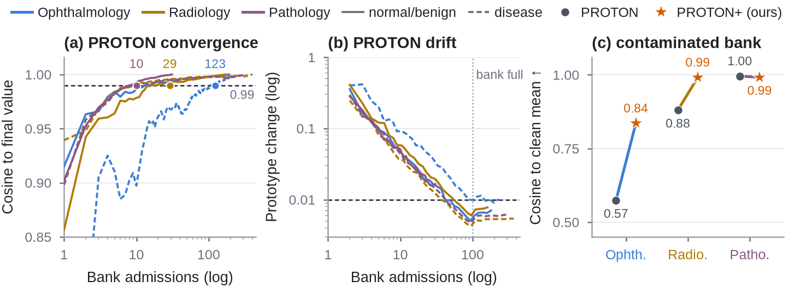

<div align="center">

# PROTON+: Contamination-Robust Prototype Banks for Test-Time Online OOD Detection with Medical VLMs

The official implementation of PROTON+, the follow-up to [PROTON](https://arxiv.org/abs/2606.20913) (MICCAI 2026): a label-free, training-free test-time OOD detector for frozen medical vision-language models, with a reusable zero-shot OOD evaluation toolkit.

</div>

**What PROTON+ changes over PROTON**

- **Domain-anchored prototypes:** a mean-shift step finds the dominant imaging-domain mode, so shifted samples that slip into a bank get almost no weight.
- **Consistency admission:** a sample enters the bank only if it is confident *and* as close to its class prototype as earlier admissions.
- **Scale-free fusion:** the softmax score and the prototype distance are fused as online z-scores.
- **Drop-in and cheap:** PROTON's hyper-parameters plus two fixed constants (h = 0.1, κ = 2) via `proton_plus_config()`, 0.1 to 0.3 ms per image on one CPU core, no labels, no training.

<div align="center">

[](https://aj-das-research.github.io/PROTON/)
[](https://aj-das-research.github.io/PROTON/demo/)
[](https://aj-das-research.github.io/PROTON/protonplus.pdf)
[](https://arxiv.org/abs/2606.20913)
[](https://huggingface.co/datasets/abhijit2k01/proton-benchmarks)
[](LICENSE)


*PROTON+, with its three changes in orange. Bottom: in the DR queue of an ultra-widefield stream, PROTON's plain mean drifts toward the shifted members and misses a real ultra-widefield image, while the domain-anchored prototype stays on the DR images and flags it.*



*PROTON (MICCAI 2026): confident test predictions fill a FIFO prototype bank per class, and the prototype distance is fused with the MCM score by a variance-driven weight.*

</div>

## Why PROTON+

PROTON fills its prototype banks from confident test predictions. On three modalities this gate admits exactly the
confidently misclassified shifted inputs, so the prototypes absorb the shift they should expose. PROTON+ keeps the bank
and the fusion and changes how the bank is filled, read and fused. It improves over MCM on every covariate and far
shift we measured, and the original PROTON stays available as the default configuration for comparison.

- **+16.4 to +47.3 AUROC points over MCM on covariate shift** and +14.9 to +63.9 on far shift, in all three modalities and on every stream order.
- **Beats PROTON in all 168 gate and bank-size settings**, and MCM in 165 of them.
- **Keeps the bank clean:** the shifted share of the most contaminated class bank drops from 63%, 59% and 16% (PROTON) to 42%, 16% and 1%.

The full story, the diagnosis and all tables are in the [PROTON+ preprint](https://aj-das-research.github.io/PROTON/protonplus.pdf) (LNCS format, a follow-up to PROTON) and on the [results page](https://aj-das-research.github.io/PROTON/results.html).

## Results

AUROC (%) per shift type, mean ± SD over five random stream orders. Each stream is the ID test set plus one OOD split.
The table is generated from the outputs of `proton run` by `scripts/readme_results.py`, and every other table of the preprint is on the [results page](https://aj-das-research.github.io/PROTON/results.html).

<!-- RESULTS:START -->
| Benchmark (VLM) | Method | Semantic | Covariate | Far-OOD |
|---|---|---|---|---|
| Ophthalmology · FLAIR | MCM | 75.8 | 68.9 | 78.5 |
| Ophthalmology · FLAIR | PROTON | 68.0 ± 0.9 | 46.7 ± 1.8 | 86.8 ± 3.6 |
| Ophthalmology · FLAIR | **PROTON+** | **67.3 ± 0.7** | **85.3 ± 7.8** | **93.4 ± 0.5** |
| Radiology · UniMed-CLIP | MCM | 54.2 | 46.6 | 27.6 |
| Radiology · UniMed-CLIP | PROTON | 55.3 ± 0.9 | 61.2 ± 1.7 | 93.9 ± 2.3 |
| Radiology · UniMed-CLIP | **PROTON+** | **61.4 ± 0.7** | **93.9 ± 0.6** | **91.5 ± 1.4** |
| Pathology · QuiltNet | MCM | 59.8 | 66.1 | 67.1 |
| Pathology · QuiltNet | PROTON | 64.9 ± 1.3 | 73.0 ± 3.7 | 75.2 ± 3.7 |
| Pathology · QuiltNet | **PROTON+** | **82.4 ± 0.3** | **85.6 ± 0.9** | **92.1 ± 0.7** |
<!-- RESULTS:END -->



*(a) Covariate AUROC against the ID fraction of the stream. (b) Covariate AUROC against the gate γ. (c) Shifted share of the most contaminated class bank, PROTON against PROTON+.*

<details>
<summary><b>More figures</b>: embedding view, gate × bank-size grid, prototype convergence</summary>



*Shifted inputs fall inside the ID range of the softmax score but form separate clusters in embedding space.*



*PROTON+ beats PROTON in all 168 gate and bank-size settings and stays above MCM in all but three of them.*



*Prototypes settle within thirty admissions in five of six banks, and PROTON+ keeps the most contaminated bank close to the clean class.*

</details>

The curated benchmarks (parquet images, cached embeddings, prompt embeddings, manifests) are on the Hugging Face Hub at [abhijit2k01/proton-benchmarks](https://huggingface.co/datasets/abhijit2k01/proton-benchmarks), so every number can be recomputed on a CPU without downloading any source dataset. Benchmarks: ophthalmology = FIVES normal/DR vs glaucoma+AMD, DeepDRiD ultra-widefield, ImageNet; radiology = RSNA
normal/opacity vs NIH ChestX-ray14 other findings, paediatric CXR, ImageNet; pathology = PatchCamelyon vs NCT-CRC
tissue types, Camelyon17-WILDS other hospital, ImageNet. Every image list is a committed, seeded manifest.

## Use it

```bash
pip install -e ".[models,data,plots]"      # core is numpy / scipy / scikit-learn only
```

```python
from proton import PROTON, score_stream, ood_metrics
from proton.online import proton_plus_config

# embeds: (N, d) l2-normalised image embeddings in stream order; text: (C, d) class-prompt embeddings
out = score_stream(embeds, text, logit_scale=model.logit_scale, config=proton_plus_config())   # PROTON+
base = score_stream(embeds, text, logit_scale=model.logit_scale)                                # original PROTON
print(ood_metrics(out["score"], is_ood))                                                        # AUROC / AUPR / FPR@95
```

Streaming, one sample at a time:

```python
det = PROTON(n_classes=2, config=proton_plus_config())
for e, p, s_mcm in stream:          # embedding, softmax over class prompts, any base score (higher = more OOD)
    rec = det.step(e, p, s_mcm)     # rec["score"], rec["s_proto"], rec["alpha"], rec["calibrated"], ...
```

Any base score works (`proton.scores.static`: MCM, Max-Logit, Energy, GL-MCM, TAG-MCM, hierarchical MCM), and any
`open_clip` checkpoint can be the VLM.

## Evaluate on your own data in three commands

```bash
proton make-benchmark --name myretina --vlm flair \
    --id normal=/data/id/normal --id "diabetic retinopathy=/data/id/dr" \
    --ood semantic=/data/glaucoma --ood covariate=/data/uwf --ood far=/data/natural \
    --prompt "A fundus photograph of {}" --n-id 150 --n-ood 150 --bank 50
CUDA_VISIBLE_DEVICES=0 proton extract --benchmark myretina      # cached features -> outputs/features/
proton run --benchmark myretina                                 # every table -> outputs/results/myretina/*.md
```

`make-benchmark` writes a manifest and registers the benchmark; `--vlm` accepts `flair`, `unimedclip`, `quiltnet` or
`open_clip:<hub id>`. To add a model, subclass `proton.models.base.VLM` (four methods) and register it with
`@proton.models.register("name")`. `proton run` produces the main zero-shot table, component / γ / M ablations, the
ID-fraction sweep, PROTON on six base scores, privileged kNN / Mahalanobis baselines, robustness extras, the γ × M
grid, the PROTON+ comparison and a prompt-sensitivity table, all as Markdown and JSON.

## Rebuild every table and figure

```bash
tools/fetch_third_party.sh && pip install -e third_party/FLAIR
tools/download_data.sh && tools/download_weights.sh      # ~12 GB of public datasets, three checkpoints
proton prepare-data                                      # seeded manifests (de-duplicates NIH against RSNA)
for b in ophthalmology radiology pathology; do proton extract --benchmark $b && proton run --benchmark $b; done
python scripts/contamination_stats.py && python scripts/extra_stats.py && python scripts/make_paper_tables.py
for f in figures_src/fig{2_embedding,3_results_v2,4_convergence,5_gamma_M}.py; do python $f; done
python scripts/readme_results.py && python scripts/build_site.py         # README block, results page, headline
```

The method figure is TikZ (`figures_src/tikz_method/fig_method.tex`, built with any LaTeX engine). Without the raw
datasets, the cached embeddings on the [Hugging Face Hub](https://huggingface.co/datasets/abhijit2k01/proton-benchmarks)
give every number on a CPU.

## Layout

```
proton/            models/ (FLAIR, UniMed-CLIP, QuiltNet, open_clip), data/ (registry, manifests, make-benchmark),
                   scores/ (static + feature-bank baselines), online.py (PROTON, PROTON+), evaluate.py, streams.py,
                   features.py, metrics.py, experiments/ (tables, figures), cli.py
tests/             pytest (incl. a JavaScript-vs-Python parity test for the browser demo)
data/benchmarks/   committed manifests (images are downloaded by tools/download_data.sh)
docs/              project page, browser demo (int8 ONNX of FLAIR's vision tower), figures, results, preprint PDF
figures_src/       editable sources of every figure (TikZ method figure, matplotlib result figures)
REPORT.md          short pointer to the preprint and the method changes
```

## Citation

```bibtex
@inproceedings{das2026proton,
  title={PROTON: Prototype-Based Test-Time Online OOD Detection for Medical VLMs},
  author={Das, Abhijit and Wasalathilaka, Nichula and Lu, Yifan and Dukre, Adinath and Mahapatra, Dwarikanath and Khan, Shadab and Razzak, Imran},
  booktitle={International Conference on Medical Image Computing and Computer-Assisted Intervention},
  pages={527--537},
  year={2026},
  organization={Springer}
}
@misc{das2026protonplus,
  title  = {PROTON+: Contamination-Robust Prototype Banks for Test-Time Online OOD Detection with Medical VLMs},
  author = {Das, Abhijit and Wasalathilaka, Nichula and Lu, Yifan and Dukre, Adinath and Mahapatra, Dwarikanath and Khan, Shadab and Razzak, Imran},
  year   = {2026},
  note   = {Preprint, https://github.com/aj-das-research/PROTON}
}
```

FLAIR (Apache-2.0), UniMed-CLIP and QuiltNet are used as frozen models; FIVES (CC BY 4.0), DeepDRiD, Imagenette,
RSNA Pneumonia, NIH ChestX-ray14, Kermany et al. paediatric CXR, PatchCamelyon, Camelyon17-WILDS and NCT-CRC-HE are
used under their own licenses. The benchmark construction follows Ju et al. (MICCAI 2025).
