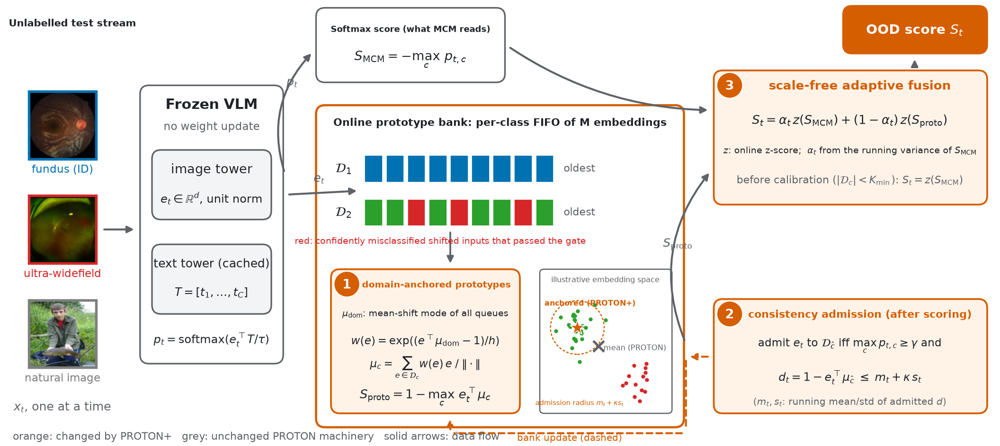

<div align="center">

# PROTON+

**Contamination-robust prototype banks for test-time online out-of-distribution detection with medical vision-language models**

*Official implementation of PROTON+ and of its predecessor PROTON, plus a reusable zero-shot OOD evaluation toolkit*

[](https://aj-das-research.github.io/PROTON/)
[](https://aj-das-research.github.io/PROTON/demo/)
[](REPORT.md)
[](https://arxiv.org/abs/2606.20913)
[](LICENSE)



</div>

PROTON+ is the follow-up to **PROTON** (Das et al., 2026), our prototype-based test-time online OOD detector for
medical vision-language models (VLMs). PROTON keeps a bank of class prototypes filled from confident test
predictions and fuses the distance to the nearest prototype with the maximum-concept-matching (MCM) score, so that
inputs from a new camera or population that look confident to the softmax can still be flagged. When we
re-implemented PROTON from scratch on three modalities we found that its confidence gate admits exactly the
confidently misclassified shifted inputs, so the prototypes absorb the shift. PROTON+ fixes this with three changes
(orange in the figure) and the same hyper-parameters:

1. **Domain-anchored prototypes.** A mean-shift step over the union of all class banks finds the dominant imaging-domain mode; each class prototype is the mean of its bank weighted by proximity to that mode.
2. **Consistency admission.** A sample enters the bank only if it is confident *and* within the typical prototype distance of previously admitted samples.
3. **Scale-free fusion.** The two signals are fused as online z-scores instead of raw values.

Use PROTON+ instead of PROTON: it is better on every covariate and far shift we measured, it costs 0.1 to 0.3 ms per
sample on a CPU core, and the original algorithm remains available as the default configuration for comparison.
The full story, the diagnosis and all tables are in the [technical report](REPORT.md).

## Results

AUROC (%) per shift type, mean ± SD over five random stream orders. Each stream is the ID test set plus one OOD split.
All numbers are regenerated from `outputs/results/` by `scripts/readme_results.py`; nothing is copied from a paper.

<!-- RESULTS:START -->
| Benchmark (VLM) | Method | Semantic | Covariate | Far-OOD |
|---|---|---|---|---|
| Ophthalmology · FLAIR | MCM | 75.8 | 68.9 | 78.5 |
| Ophthalmology · FLAIR | PROTON | 68.0 ± 0.9 | 46.7 ± 1.8 | 86.8 ± 3.6 |
| Ophthalmology · FLAIR | **PROTON+** | **67.3 ± 0.7** | **85.3 ± 7.8** | **93.4 ± 0.5** |
| Radiology · UniMed-CLIP | MCM | 54.2 | 46.6 | 27.6 |
| Radiology · UniMed-CLIP | PROTON | 55.3 ± 0.9 | 61.2 ± 1.7 | 93.9 ± 2.3 |
| Radiology · UniMed-CLIP | **PROTON+** | **61.4 ± 0.7** | **93.9 ± 0.6** | **91.5 ± 1.4** |
| Pathology · QuiltNet | MCM | 59.8 | 66.1 | 67.1 |
| Pathology · QuiltNet | PROTON | 64.9 ± 1.3 | 73.0 ± 3.7 | 75.2 ± 3.7 |
| Pathology · QuiltNet | **PROTON+** | **82.4 ± 0.3** | **85.6 ± 0.9** | **92.1 ± 0.7** |
<!-- RESULTS:END -->

Benchmarks: ophthalmology = FIVES normal/DR vs glaucoma+AMD, DeepDRiD ultra-widefield, ImageNet; radiology = RSNA
normal/opacity vs NIH ChestX-ray14 other findings, paediatric CXR, ImageNet; pathology = PatchCamelyon vs NCT-CRC
tissue types, Camelyon17-WILDS other hospital, ImageNet. Every image list is a committed, seeded manifest.

## Use it

```bash
pip install -e ".[models,data,plots]"      # core is numpy / scipy / scikit-learn only
```

```python
from proton import PROTON, score_stream, ood_metrics
from proton.online import proton_plus_config

# embeds: (N, d) l2-normalised image embeddings in stream order; text: (C, d) class-prompt embeddings
out = score_stream(embeds, text, logit_scale=model.logit_scale, config=proton_plus_config())   # PROTON+
base = score_stream(embeds, text, logit_scale=model.logit_scale)                                # original PROTON
print(ood_metrics(out["score"], is_ood))                                                        # AUROC / AUPR / FPR@95
```

Streaming, one sample at a time:

```python
det = PROTON(n_classes=2, config=proton_plus_config())
for e, p, s_mcm in stream:          # embedding, softmax over class prompts, any base score (higher = more OOD)
    rec = det.step(e, p, s_mcm)     # rec["score"], rec["s_proto"], rec["alpha"], rec["calibrated"], ...
```

Any base score works (`proton.scores.static`: MCM, Max-Logit, Energy, GL-MCM, TAG-MCM, hierarchical MCM), and any
`open_clip` checkpoint can be the VLM.

## Evaluate on your own data in three commands

```bash
proton make-benchmark --name myretina --vlm flair \
    --id normal=/data/id/normal --id "diabetic retinopathy=/data/id/dr" \
    --ood semantic=/data/glaucoma --ood covariate=/data/uwf --ood far=/data/natural \
    --prompt "A fundus photograph of {}" --n-id 150 --n-ood 150 --bank 50
CUDA_VISIBLE_DEVICES=0 proton extract --benchmark myretina      # cached features -> outputs/features/
proton run --benchmark myretina                                 # every table -> outputs/results/myretina/*.md
```

`make-benchmark` writes a manifest and registers the benchmark; `--vlm` accepts `flair`, `unimedclip`, `quiltnet` or
`open_clip:<hub id>`. To add a model, subclass `proton.models.base.VLM` (four methods) and register it with
`@proton.models.register("name")`. `proton run` produces the main zero-shot table, component / γ / M ablations, the
ID-fraction sweep, PROTON on six base scores, privileged kNN / Mahalanobis baselines, robustness extras, the γ × M
grid, the PROTON+ comparison and a prompt-sensitivity table, all as Markdown and JSON.

## Reproduce the report

```bash
tools/fetch_third_party.sh && pip install -e third_party/FLAIR
tools/download_data.sh && tools/download_weights.sh      # ~12 GB of public datasets, three checkpoints
proton prepare-data                                      # seeded manifests (de-duplicates NIH against RSNA)
for b in ophthalmology radiology pathology; do proton extract --benchmark $b && proton run --benchmark $b; done
proton figures && python scripts/contamination_stats.py && python scripts/extra_stats.py
python scripts/build_report.py && python scripts/readme_results.py && python scripts/build_site.py
```

## Layout

```
proton/            models/ (FLAIR, UniMed-CLIP, QuiltNet, open_clip), data/ (registry, manifests, make-benchmark),
                   scores/ (static + feature-bank baselines), online.py (PROTON, PROTON+), evaluate.py, streams.py,
                   features.py, metrics.py, experiments/ (tables, figures), cli.py
tests/             pytest (incl. a JavaScript-vs-Python parity test for the browser demo)
data/benchmarks/   committed manifests (images are downloaded by tools/download_data.sh)
docs/              project page, browser demo (int8 ONNX of FLAIR's vision tower), figures, results
paper/             PROTON+ manuscript (Overleaf-synced)   figures_src/  editable figure sources
REPORT.md          the PROTON+ follow-up report (generated numbers)
```

## Citation

```bibtex
@article{das2026proton,
  title   = {PROTON: Prototype-Based Test-Time Online OOD Detection for Medical VLMs},
  author  = {Das, Abhijit and Wasalathilaka, Nichula and Lu, Yifan and Dukre, Adinath and Mahapatra, Dwarikanath and Khan, Shadab and Razzak, Imran},
  journal = {arXiv preprint arXiv:2606.20913},
  year    = {2026}
}
@misc{das2026protonplus,
  title  = {PROTON+: Contamination-Robust Prototype Banks for Test-Time Online OOD Detection with Medical VLMs},
  author = {Das, Abhijit and Wasalathilaka, Nichula and Lu, Yifan and Dukre, Adinath and Mahapatra, Dwarikanath and Khan, Shadab and Razzak, Imran},
  year   = {2026},
  note   = {Technical report, https://github.com/aj-das-research/PROTON}
}
```

FLAIR (Apache-2.0), UniMed-CLIP and QuiltNet are used as frozen models; FIVES (CC BY 4.0), DeepDRiD, Imagenette,
RSNA Pneumonia, NIH ChestX-ray14, Kermany et al. paediatric CXR, PatchCamelyon, Camelyon17-WILDS and NCT-CRC-HE are
used under their own licenses. The benchmark construction follows Ju et al. (MICCAI 2025).
